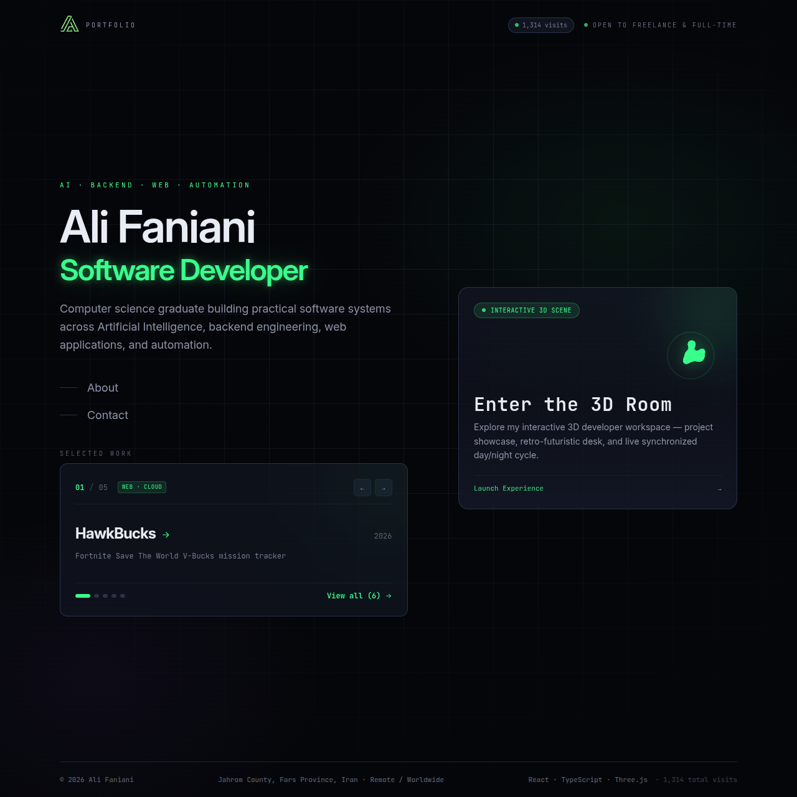
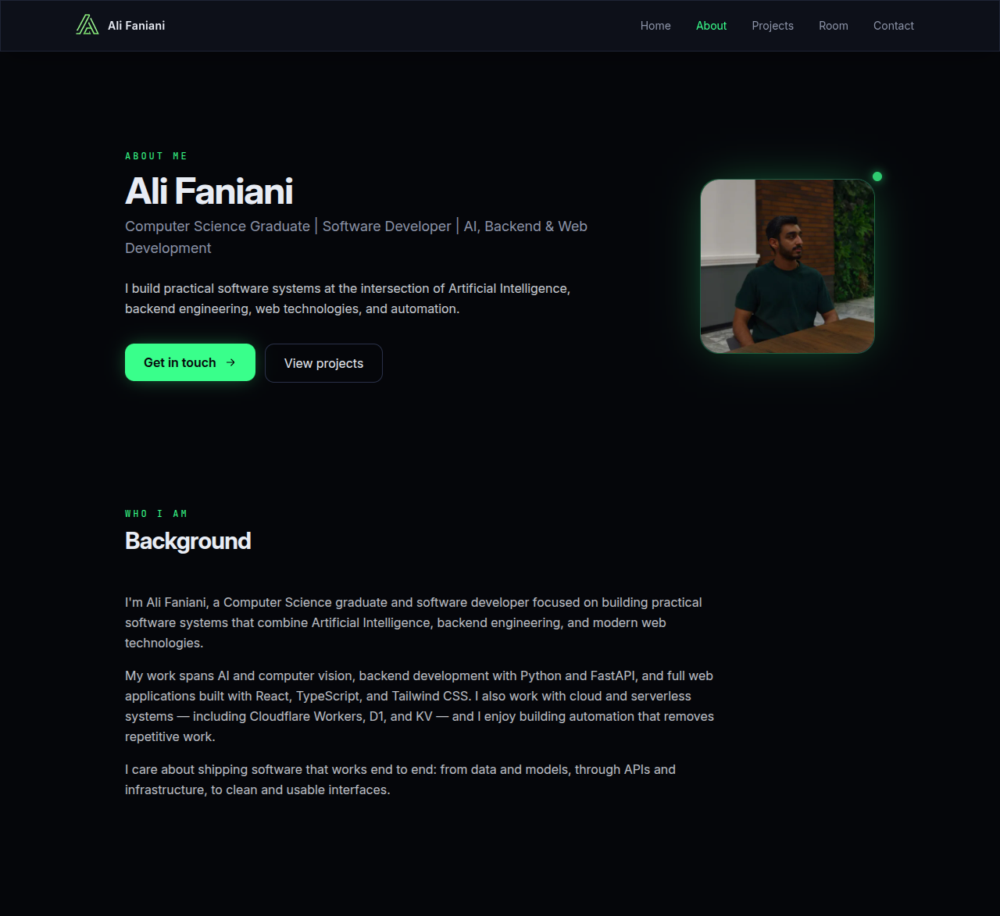
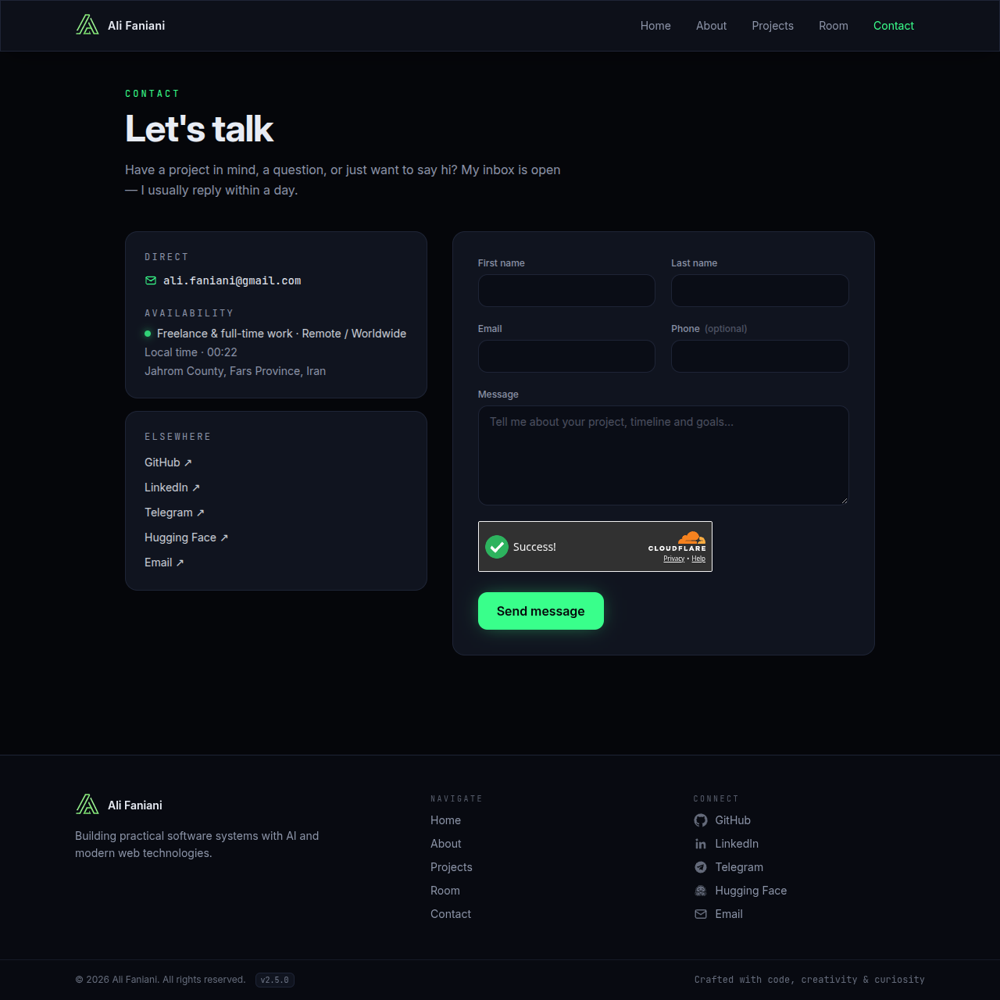
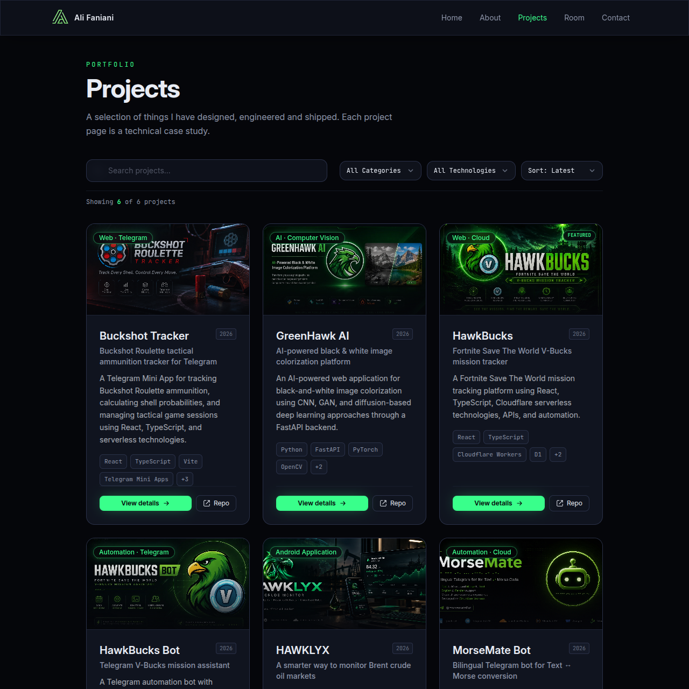

<div align="center">

<a href="https://alifaniani.ir">
  
</a>

# Ali Faniani — Portfolio

### Software Developer · AI · Backend · Web · Automation

<p>
  <a href="https://alifaniani.ir">🌐 Live Website</a>
  &nbsp;·&nbsp;
  <a href="https://alifaniani.ir/room">🧊 3D Developer Room</a>
  &nbsp;·&nbsp;
  <a href="https://github.com/Greenhawk5/AliFaniani-Portfolio">💻 Repository</a>
</p>

<p>
  
  
  
  
  
  
  
  
  
</p>


</div>

---

## ✦ Overview

This repository contains the production source code for my personal developer portfolio at [alifaniani.ir](https://alifaniani.ir).

The project is built around a dual-experience architecture:
1. **A content-first, high-performance static portfolio:** Designed for instant loading, search engines, mobile responsiveness, and accessibility. It intentionally loads zero Three.js, WebGL, or 3D asset code.
2. **An interactive 3D developer room at `/room`:** A fully realized 3D workspace powered by React Three Fiber, featuring interactive lighting, physical room objects, project showcase screens, day/night cycles, and mobile touch camera controls.
3. **An integrated, private Admin Control Center at `/admin`:** A full-featured, zero-trust administrative suite managing dynamic content, Cloudflare R2 media storage, selective publishing, live system health diagnostics, first-party privacy-preserving analytics, and notifications.

> **Philosophy:** Deliver an interactive experience that feels like a real digital product, while maintaining strict code isolation, sub-second initial page loads, and enterprise-grade reliability.

---

## ✦ Visual Gallery

### Public Portfolio Experience

<table>
<tr>
<td width="33%" align="center">
<a href="docs/screenshots/Home.png"></a>
<br /><sub><b>Homepage & Selected Work</b><br />Fluid typography, 3D portal, and carousel</sub>
</td>
<td width="33%" align="center">
<a href="docs/screenshots/About.png"></a>
<br /><sub><b>About & Background</b><br />Developer profile, skills, and background</sub>
</td>
<td width="33%" align="center">
<a href="docs/screenshots/Contact.png"></a>
<br /><sub><b>Contact & Inquiries</b><br />Turnstile-protected messaging and availability</sub>
</td>
</tr>
</table>

### Projects & Technical Case Studies

<table>
<tr>
<td width="50%" align="center">
<a href="docs/screenshots/Projects.png"></a>
<br /><sub><b>Projects Directory</b><br />Searchable catalog with real-time category & tech filters</sub>
</td>
<td width="50%" align="center">
<a href="docs/screenshots/Project%20Example.png"></a>
<br /><sub><b>Technical Case Study (HawkBucks)</b><br />Architecture breakdown, technical specs, and live actions</sub>
</td>
</tr>
</table>

### Interactive 3D Developer Room (`/room`)

<table>
<tr>
<td colspan="2" align="center">
<a href="docs/screenshots/3D-Room%20(1).png"></a>
<br /><sub><b>Cinematic Isometric Room Perspective</b><br />Dynamic day/night cycle, neon signage, and mobile touch camera controls</sub>
</td>
</tr>
<tr>
<td width="50%" align="center">
<a href="docs/screenshots/3D-Room%20(3).webp"></a>
<br /><sub><b>Developer Workstation</b><br />Interactive monitor, RGB PC tower, and peripherals</sub>
</td>
<td width="50%" align="center">
<a href="docs/screenshots/3D-Room%20(2).webp"></a>
<br /><sub><b>Stylized Scene Elements</b><br />Custom 3D wall shelf, lighting, and ambient assets</sub>
</td>
</tr>
</table>

> 🧊 **Experience the room live:** [`alifaniani.ir/room`](https://alifaniani.ir/room)

### Portfolio Control Center (`/admin`)

<table>
<tr>
<td width="50%" align="center">
<a href="docs/screenshots/Admin%20Login.png"></a>
<br /><sub><b>Zero-Trust Sign-In</b><br />Digital rain backdrop with Turnstile challenge verification</sub>
</td>
<td width="50%" align="center">
<a href="docs/screenshots/Admin%20Panel%20(1).png"></a>
<br /><sub><b>Admin Dashboard & Live Insights</b><br />Live content tallies, deployment queue, and 14-day activity pulse</sub>
</td>
</tr>
<tr>
<td width="50%" align="center">
<a href="docs/screenshots/Admin%20Panel%20(2).png"></a>
<br /><sub><b>Cloudflare R2 Media Library</b><br />Direct R2 storage with drag-and-drop upload & MIME validation</sub>
</td>
<td width="50%" align="center">
<a href="docs/screenshots/Admin%20Panel%20(3).png"></a>
<br /><sub><b>System Activity & Audit Trail</b><br />EvilCharts event distribution donut and paginated edge audit log</sub>
</td>
</tr>
</table>

---

## ✦ Tech Stack

### Frontend

<p>
  
  
  
  
  
</p>

### 3D & Motion

<p>
  
  
  
  
  
</p>

### State & Data

<p>
  
  
  
  
</p>

### Cloud & Infrastructure

<p>
  
  
  
  
  
  
</p>

---

## ✦ Key Highlights (v2.5.0)

| Feature | Architecture & Implementation |
|---|---|
| ⚡ **Performance-First Isolation** | The landing page and public routes ship zero 3D overhead. Three.js, R3F, shaders, and GLB decoders are isolated exclusively to `/room`. |
| 🧊 **Responsive 3D Room Camera** | Geometry-based dynamic object framing (`box.getSize()`), mobile touch orbit with momentum damping, two-finger pinch-to-zoom, and virtual joystick for freecam mode. |
| 🚀 **Selective CMS Publishing** | Multi-item draft promotion interface allowing administrators to choose specific pending changes to deploy rather than forcing an all-or-nothing publish. |
| 🛡️ **Zero-Trust Diagnostics** | Server-side health probe (`/api/admin/system/health`) measuring real D1 query latency, table counts, KV bindings, R2 accessibility, and secrets posture without leaking credentials. |
| 📊 **First-Party Analytics** | Privacy-preserving traffic metrics powered by daily rotating salted SHA-256 session hashes (`sha256Hex(ip::ua::date::salt)`). Raw IPs are never stored. |
| 🖼️ **Cloudflare R2 Media Storage** | Direct asset management with binary magic-byte MIME sniffing (WebP, PNG, JPEG, AVIF), dimension sniffing, atomic upload compensation, and safe deletion checks. |
| 🔍 **Search & Social SEO Engine** | Verified Google Search Site Name branding (`Ali Faniani`), static SSR HTML shells, JSON-LD `@graph` entities, dynamic D1 edge fallbacks, and automated sitemap synchronization. |
| 🔒 **Hardened Session Governance** | 15-minute idle inactivity timeout, 24-hour absolute session ceiling, sliding activity refresh, probe-mode verification, CSRF defense-in-depth, and fail-closed Turnstile. |
| 📱 **Fluid Mobile Typography** | CSS `clamp(2.5rem, 8vw, 4.25rem)` hero typography, natural multi-line wrapping in the Selected Work carousel, and zero horizontal viewport overflows. |
| ☁️ **Deterministic Sync Pipeline** | Atomic D1 updates trigger a dedicated GitHub Actions workflow that regenerates static snapshots on `main` before firing the Cloudflare Pages deploy hook. |

---

## ✦ Selected Projects Showcase

<table>
<tr>
<td width="33%" align="center">
<a href="https://alifaniani.ir/projects/greenhawk-ai">

</a>
<h3>GreenHawk AI</h3>
<sub>AI image colorization platform</sub>
</td>

<td width="33%" align="center">
<a href="https://alifaniani.ir/projects/hawkbucks">

</a>
<h3>HawkBucks</h3>
<sub>Fortnite V-Bucks mission tracker</sub>
</td>

<td width="33%" align="center">
<a href="https://alifaniani.ir/projects/hawkbucks-bot">

</a>
<h3>HawkBucks Bot</h3>
<sub>Telegram V-Bucks assistant</sub>
</td>
</tr>
</table>

---

## ✦ System Architecture & Publishing Pipeline

### Cloudflare Edge Architecture

```text
                               ┌──────────────────────────────┐
                               │       Client Web Browser     │
                               └──────────────┬───────────────┘
                                              │
                                              ▼
                               ┌──────────────────────────────┐
                               │  Cloudflare Global Edge CDN  │
                               ├──────────────────────────────┤
                               │ • Edge SSR Fallback Gate     │
                               │ • Security Headers & CSP     │
                               │ • Static HTML Shell Delivery │
                               └──────────────┬───────────────┘
                                              │
                        ┌─────────────────────┼─────────────────────┐
                        ▼                     ▼                     ▼
              ┌──────────────────┐  ┌──────────────────┐  ┌──────────────────┐
              │  Fast Public Web │  │  Lazy 3D Engine  │  │  Private Admin   │
              │  • SEO Shells    │  │  • /room route   │  │  • /admin route  │
              │  • Zero WebGL    │  │  • Three.js/R3F  │  │  • Zero-Trust    │
              │  • Pure HTML/CSS │  │  • Touch Orbit   │  │  • Hash-routed   │
              └─────────┬────────┘  └─────────┬────────┘  └─────────┬────────┘
                        │                     │                     │
                        └─────────────────────┼─────────────────────┘
                                              ▼
                               ┌──────────────────────────────┐
                               │   Pages Functions Edge API   │
                               │ /api/contact  /api/analytics │
                               │ /api/admin/*  /api/projects  │
                               └──────────────┬───────────────┘
                                              │
                    ┌─────────────────────────┼─────────────────────────┐
                    ▼                         ▼                         ▼
         ┌────────────────────┐    ┌────────────────────┐    ┌────────────────────┐
         │   Cloudflare D1    │    │   Cloudflare KV    │    │   Cloudflare R2    │
         │ • Content Store    │    │ • Rate Limiting    │    │ • Media Storage    │
         │ • Session Hashes   │    │ • deploy:state     │    │ • Magic-Byte MIME  │
         │ • Audit Trail      │    │ • Brute Lockouts   │    │ • Reference Safety │
         │ • Analytics Events │    └────────────────────┘    └────────────────────┘
         └────────────────────┘
```

### Deterministic Publishing State Machine

```text
 1. CMS EDITING           2. ATOMIC PROMOTION         3. REPOSITORY SYNC
┌──────────────────┐      ┌────────────────────────┐  ┌──────────────────────────┐
│ Validate drafts  │ ───► │ Promote selected       ├──►│ Dispatch GitHub Actions  │
│ in Admin UI      │      │ records to D1          │   │ cms-snapshot-sync.yml    │
└──────────────────┘      └────────────────────────┘   └────────────┬─────────────┘
                                                                    │
 6. GLOBAL EDGE CDN       5. CLOUDFLARE BUILD         4. DETERMINISTIC EXPORT
┌──────────────────┐      ┌────────────────────────┐  ┌─────────────┴────────────┐
│ Serve immutable  │ ◄─── │ Build static bundles   │◄──│ Export D1 snapshot to    │
│ static website   │      │ and route SSR shells   │   │ content.json & sitemap   │
└──────────────────┘      └────────────────────────┘   └──────────────────────────┘
```

---

## ✦ Interactive 3D Room Architecture

The `/room` route is an interactive 3D digital developer workstation built with React Three Fiber:

- **Dynamic Environment & Lighting:** Continuous day/night sky interpolation synchronized with visitor local time (with manual override in settings). Custom GLSL shaders render dynamic skies, stars, and atmospheric haze.
- **Showcase Board Optimization:** Pre-renders 52 background grid lines and gradients to offscreen canvases; canvas re-draws and GPU texture uploads (`texture.needsUpdate = true`) execute **strictly during active slide transitions** (0% GPU texture overhead during idle states; instantaneous 350ms slide navigation).
- **Verified Visitor Sign:** Renders real, verified visitor counts onto a branded 3D board beneath the digital clock, fetched from `/api/analytics/stats`.
- **Geometry-Based Camera Framing:** Calculates bounding boxes (`box.getSize()`) in real time, adapting focal distance and vertical look offset dynamically based on device aspect ratio.
- **Mobile Touch Orbit & Freecam:** Touch gesture orbit with momentum damping, two-finger pinch-to-zoom, and an ergonomic virtual joystick for free-camera navigation on touchscreens.

---

## ✦ Portfolio Control Center (`/admin`)

A private, single-owner administration suite is built into the site at `/admin`. It is deliberately unlisted: the only intentional entry point is a subtle key icon inside the site's Settings panel, plus the direct URL. It does not appear in navigation, footer, sitemap, or robots.txt, and is served with `X-Robots-Tag: noindex, nofollow, noarchive` and `Cache-Control: no-store`.

The console is hash-routed across nine specialized management surfaces:
- **Overview (`#/overview`):** High-level operational metrics, live content counts, pending publish alerts, deployment status, and 14-day activity pulse.
- **Projects (`#/projects`):** Full CRUD for project case studies, custom technology tags, repository links, live demos, and homepage showcase toggles.
- **Profile (`#/profile`):** Management of biography paragraphs, skill groups, timeline milestones, education, and credentials.
- **Links (`#/links`):** Management of public social links, external profiles, and contact channels.
- **Media Library (`#/media`):** R2 asset browser with category organization, binary MIME validation, dimension sniffing, direct URL copying, and reference integrity protection.
- **Publishing (`#/publishing`):** Selective publishing interface with item-by-item selection, visual draft/published diffing, sync status tracking, and manual sync retry.
- **SEO Center (`#/seo`):** Actionable audit dashboard with indexing posture indicators, canonical checks, diagnostic severity checklist, route inspection table, and one-click jump-to-remedy links.
- **Activity Log (`#/activity`):** Audit trail over `auth_log` with default IP masking, per-session full IP reveal, authoritative edge country (`CF-IPCountry`), and 14-day activity pulse.
- **Integrations (`#/integrations`):** Real-time status registry across 10 cloud services with observed evidence, failure consequences, and visual publishing architecture.
- **Settings (`#/settings`):** 5-domain categorized settings (*Account & Session*, *Application & Build*, *Content & Publishing*, *Infrastructure & Bindings*, *Security & Secrets*), copyable version tokens (`v2.5.0`), and safe sign-out workflow.

---

## ✦ Security Architecture

Security is implemented natively across every layer of the application:

| Security Domain | Implementation Details |
|---|---|
| **Single-Owner Authentication** | Password-only authentication with zero user registration surface. `ADMIN_PASSWORD` is an encrypted Cloudflare secret; comparison is crypto-grade timing-safe. |
| **Session Lifetime Governance** | Enforces a 15-minute idle inactivity timeout and a 24-hour absolute session ceiling. Expired sessions are rejected and purged opportunistically. |
| **Probe-Mode Protection** | Monitoring and health checks pass `isProbe: true` to prevent diagnostic polling from artificially extending session lifespans. |
| **CSRF Defense-in-Depth** | Every administrative mutation requires a timing-safe per-session `X-CSRF-Token` in addition to `SameSite=Strict` cookies. |
| **Cloudflare Turnstile** | Server-enforced, fail-closed Turnstile challenge validation on both admin login and public contact form submissions. |
| **Layered Rate Limiting** | In-memory burst cap per Cloudflare isolate + KV-backed IP lockout counting Turnstile-passed password failures (5 attempts per 15 minutes). |
| **R2 Binary Magic-Byte Sniffing** | Strictly allows WebP, PNG, JPEG, and AVIF; SVG payloads, scripts, and executables are rejected at binary inspection. |
| **Zero-Trust Secrets Posture** | Sensitive credentials (`ADMIN_PASSWORD`, `TURNSTILE_SECRET`, `GITHUB_SYNC_TOKEN`, `RESEND_API_KEY`, `DEPLOY_HOOK_URL`) never touch client code or public bundles. |
| **Edge Security Headers** | Strict HSTS (`includeSubDomains`), restrictive Content Security Policy (CSP), `X-Content-Type-Options: nosniff`, `X-Frame-Options: DENY`, `frame-ancestors 'none'`, and `Permissions-Policy`. |
| **Bundle Isolation Verified** | Automated build checks verify that no Zod runtime, admin markers, or server secret strings leak into public client bundles. |

---

## ✦ Database Architecture & Migrations

Cloudflare D1 is the single source of truth for dynamic portfolio content and audit trails.

### Database Schema Overview
- `content`: Stores `project`, `profile`, and `link` entities with versioning, draft overlays (`draft_data`, `draft_updated_at`), sort orders, and states (`draft`, `published`, `archived`).
- `sessions`: Stores SHA-256 hashes of 256-bit session tokens, CSRF token hashes, creation timestamps, `last_used_at`, and expiration ceilings.
- `auth_log`: Append-only security audit log (`ts`, `ip`, `country`, `ok`, `note`).
- `media_assets`: Metadata registry for R2 objects (`id`, `r2_key`, `url`, `mime_type`, `bytes`, `width`, `height`, `category`, `associated_key`, `state`).
- `page_view_events`: First-party analytics events recording salted daily session hashes, route paths, referrers, device types, and bot flags.
- `analytics_daily` & `project_analytics_daily`: Aggregated daily traffic summaries.
- `admin_notifications`: System alerts and action items with state tracking (`active`, `acknowledged`, `resolved`, `expired`).

### Applied Migrations
1. `0001_init.sql` — Initial schema (`content`, `sessions`, `auth_log`).
2. `0002_add_draft_columns.sql` — Support for non-destructive draft overlays.
3. `0003_auth_log_country.sql` — Edge geolocation capture via `CF-IPCountry`.
4. `0004_auth_log_indexing.sql` — Performance index on `auth_log(ts DESC)`.
5. `0005_media_assets.sql` — Cloudflare R2 media asset table and reference indices.
6. `0006_analytics_and_notifications.sql` — Tables for visitor tracking and admin notifications.

---

## ✦ Installation & Local Development

### Prerequisites
- [Node.js](https://nodejs.org/) (v20 or v22 recommended)
- [npm](https://www.npmjs.com/) (v10+)
- [Cloudflare Wrangler](https://developers.cloudflare.com/workers/wrangler/) (optional, for local Workers/Pages simulation)

### Setup Instructions

1. **Clone the repository:**
   ```bash
   git clone https://github.com/Greenhawk5/AliFaniani-Portfolio.git
   cd AliFaniani-Portfolio
   ```

2. **Install dependencies:**
   ```bash
   npm ci
   ```

3. **Configure local environment:**
   Copy the example environment file:
   ```bash
   cp .env.example .env
   ```
   For local Cloudflare Pages simulation (`wrangler pages dev`), create a `.dev.vars` file in the root directory (never committed):
   ```ini
   ADMIN_PASSWORD=your-local-password
   TURNSTILE_SECRET=1x0000000000000000000000000000000AA
   VITE_TURNSTILE_SITE_KEY=1x0000000000000000000000000000000AA
   ```

4. **Start Vite development server:**
   ```bash
   npm run dev
   ```

5. **Run Cloudflare-compatible local runtime (with Functions & D1):**
   ```bash
   npm run build
   npx wrangler pages dev dist
   ```

---

## ✦ Available npm Scripts

| Command | Description |
|---|---|
| `npm run dev` | Starts Vite local development server with HMR. |
| `npm run build` | Executes orchestrated production build (version → manifest → D1 snapshot → validation → sitemap → tsc → vite → media copy → route HTML → verification). |
| `npm run preview` | Previews the compiled `dist/` directory locally. |
| `npm run typecheck` | Validates client application TypeScript (`tsc -b`). |
| `npm run check:functions` | Validates Cloudflare Pages Functions TypeScript (`tsc --noEmit -p tsconfig.functions.json`). |
| `npm run lint` | Runs ESLint across `src/` and `functions/`. |
| `npm run format` | Formats code with Prettier. |
| `npm test` | Runs complete Vitest test suite. |
| `npm run test:ci` | Runs CI test suite (excludes external credential-dependent tests). |
| `npm run verify:build` | Validates build isolation, route manifests, sitemap coverage, and secret leakage. |
| `npm run sitemap` | Regenerates `sitemap.xml` from the current content snapshot. |
| `npm run media` | Generates the static media manifest from `docs/` repository assets. |
| `npm run media:migrate` | Migrates legacy repository media to Cloudflare R2 bucket. |
| `npm run snapshot:local` | Exports a published snapshot from a local D1 instance. |
| `npm run deploy` | Compiles application and deploys `dist/` directly via Wrangler. |

---

## ✦ Testing & Quality Assurance

The repository includes comprehensive automated test coverage with **247 passing tests** across 21 test suites:

- **Unit & Schema Validation:** Zod schemas, profile facades, and project store selectors.
- **Admin Authentication & Sessions:** Timing-safe comparisons, 15-minute idle timeout, 24-hour ceiling, keepalive renewal, CSRF token validation, and IP masking.
- **System Health Diagnostics (`tests/admin-system-health.test.ts`):** Validates D1 latency reporting, KV/R2 binding detection, zero-trust boolean secrets posture, and probe-mode session protection.
- **Publishing & Snapshot Pipeline:** Draft overlay promotion, selective publishing, sync dispatch retry, and atomic error handling.
- **Analytics & Tracking:** Bot detection, device classification, daily session hash rotation, and public stats caching.
- **Media Management:** Magic-byte MIME detection, dimension sniffing, and deletion reference protection.
- **3D Room & Responsive Layout:** Camera viewport framing calculations, pitch clamping, and fluid typography scaling.
- **Build Output Verification:** Scans every compiled chunk for forbidden needles, server secrets, and Zod dependencies.

Run the test suite locally:
```bash
npm run test:ci
```

---

## ✦ Project Directory Structure

```text
AliFaniani-Portfolio/
├── .github/
│   └── workflows/
│       ├── ci.yml                 # PR & push verification workflow
│       └── cms-snapshot-sync.yml  # D1 snapshot sync & deploy hook trigger
├── docs/                          # Original documentation & image assets
│   ├── certificates/              # Certificate scans
│   ├── implementation/            # Engineering decision records & logs
│   ├── profile/                   # Showcase visual assets
│   ├── project/                   # Project banners & screenshots
│   └── screenshots/               # High-resolution application screenshots
├── functions/                     # Cloudflare Pages Functions (Edge API)
│   ├── _middleware.js             # Edge SSR shell fallback & header guard
│   ├── api/                       # API endpoints
│   │   ├── admin/                 # Private admin API (health, publish, media, etc.)
│   │   ├── analytics/             # Privacy-preserving analytics (track, stats)
│   │   ├── contact.ts             # Contact form submission endpoint
│   │   └── projects/              # Project discovery endpoint
│   └── lib/                       # Edge libraries (auth, sessions, D1 store, etc.)
├── migrations/                    # Cloudflare D1 schema migrations
├── public/                        # Static public assets, fonts, icons, decoders
├── scripts/                       # Build scripts, exporters, and verification tooling
├── src/
│   ├── admin/                     # Portfolio Control Center application
│   │   ├── views/                 # Admin views (Overview, Publishing, SEO, etc.)
│   │   ├── ui/                    # Cyberpunk form controls and EvilCharts
│   │   └── systemApi.ts           # System health diagnostics client API
│   ├── app/                       # App router, providers, and global config
│   ├── components/                # Reusable UI components & 3D scene elements
│   ├── data/                      # Route metadata & content facades
│   │   └── generated/             # Canonical content.json snapshot
│   ├── hooks/                     # Custom React hooks (analytics, meta, media)
│   ├── pages/                     # Route components (Home, About, Projects, Room, etc.)
│   ├── stores/                    # Zustand stores
│   ├── three/                     # Three.js scene graph, shaders, and camera rig
│   └── version.ts                 # Authoritative version constant (generated)
├── tests/                         # Vitest automated test suite (21 test files)
├── CHANGELOG.md                   # Chronological release changelog
├── LICENSE                        # Proprietary license agreement
├── NOTICE.md                      # Third-party asset attributions (CC BY 4.0)
├── package.json                   # Project manifest (v2.5.0)
├── README.md                      # Comprehensive project documentation
├── SECURITY.md                    # Vulnerability reporting & security model
└── wrangler.toml                  # Cloudflare Pages & D1/KV/R2 configuration
```

---

## ✦ License & Attribution

- **Original Source Code & Design:** Copyright © 2026 Ali Faniani. All rights reserved. The original code and design are **proprietary**. Public visibility on GitHub is for inspection, code review, and learning only.
- **Third-Party 3D Assets:** 3D models used in the `/room` experience are licensed under Creative Commons Attribution ([CC BY 4.0](http://creativecommons.org/licenses/by/4.0/)). Full creator credits and source links are preserved in [`NOTICE.md`](NOTICE.md).

---

## ✦ Author

**Ali Faniani** — Software Developer  
*Specializing in AI, Backend Engineering, Modern Web Technologies, and Automation.*

- 🌐 **Website:** [alifaniani.ir](https://alifaniani.ir)
- 💻 **GitHub:** [@Greenhawk5](https://github.com/Greenhawk5)
- 💼 **LinkedIn:** [in/ali-faniani](https://www.linkedin.com/in/ali-faniani)
- 🤗 **Hugging Face:** [@Greenhawk5](https://huggingface.co/Greenhawk5)

---

<div align="center">
<sub>Built with React 19, TypeScript, Three.js, and Cloudflare Pages.</sub>
</div>
